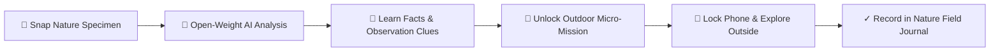

# NatureSnap AI

> **An AI-powered outdoor exploration companion built around open-weight models that turns what you discover outside into real-world micro-adventures — giving you a reason to put your phone down and touch grass.**

Built for the **Hacktoberfest Open-Source AI Challenge 2026 — Week 1 Theme: “Touch Grass”**.

---

## 🌿 Problem

People often use technology to learn about nature without actually spending time in nature. Modern applications are heavily designed around screen-time maximization, endless infinite scrolling, and digital dopamine loops that keep users sedentary indoors staring at glass.

Even conventional nature-identification apps tend to keep users on their devices: you take a photo, read a long Wikipedia wall of text on a screen, and remain on your phone.

---

## 💡 Solution

**NatureSnap AI** flips this paradigm on its head. The app is intentionally engineered to make **the screen the shortest part of the experience**:

$$\text{GO OUTSIDE} \longrightarrow \text{SNAP NATURE} \longrightarrow \text{AI IDENTIFIES IT} \longrightarrow \text{LEARN QUICK FACTS} \longrightarrow \text{GET A NATURE MISSION} \longrightarrow \text{TOUCH GRASS OUTSIDE}$$

Instead of keeping users tethered to a display, NatureSnap generates an immediate physical exploration micro-mission (e.g. *compare leaf serrations in sunlight*, *count tree lenticels*, *track pollinator visits*), launches an ambient outdoor companion mode, and tells the user:

> **“You have everything you need. Now go explore. 🌿”**  
> *Tip: Lock your phone and come back when you're done.*

---

## ✨ Features

- **Open-Weight AI Nature Identification**: Fast, structured identification of plants, leaves, trees, flowers, insects, rocks, and mushrooms powered by open models (Gemma 2 / PaliGemma architecture).
- **Uncertainty Communication**: When ambiguous, the AI candidly indicates *"I'm not completely sure"* and presents alternative possibilities and visual differentiators instead of false certainty.
- **Bite-Sized Nature Facts**: 3–4 punchy, fascinating facts emphasizing ecological uniqueness (no overwhelming walls of text).
- **Physical "Look Closer" Observation Clues**: Clues detailing leaf margins, vein symmetry, bark lenticels, and petal notches to inspect in person.
- **AI-Generated Outdoor Missions**: Tailored real-world missions categorized into *Observe*, *Compare*, *Listen*, *Count*, *Explore*, *Photograph*, *Learn*, and *Protect*.
- **"Leave the Screen" UX Mode**: Minimalist outdoor companion view with countdown timer, synthetic ambient nature breeze, and a screen-locking reminder.
- **Digital Field Journal**: Offline-friendly personal nature journal with search, category filtering, evidence photo attachments, and field notes.
- **Export Field Notes**: One-click export to Markdown (`.md`) field logs and JSON backups.
- **Exploration Streaks & Badges**: Healthy, non-addictive outdoor milestones (*🌱 First Discovery*, *🔎 Curious Explorer*, *🥾 Trail Observer*, *🌿 Nature Week*, *🦋 Biodiversity Scout*, *🍃 Master of Grass*).
- **Instant Demo Mode**: Pre-loaded with 3 rich botanical specimens (*Neem Leaf*, *Common Chicory Wildflower*, *Paper Birch Tree Bark*) for instant evaluation without requiring external keys.
- **Mobile-First & Accessible**: High-contrast, responsive nature aesthetic using Tailwind CSS and semantic keyboard navigation.

---

## 🚀 How It Works



1. **Snap or Upload**: Photograph a leaf, flower, insect, bark, or natural object using your camera or file picker. Select your activity (Walking, Hiking, Gardening), time budget, and difficulty.
2. **Open-Weight AI Analysis**: Progressive 4-stage pipeline (*Observing image → Identifying nature → Finding interesting details → Creating outdoor mission*).
3. **Inspect the Specimen**: View common & scientific binomial names, confidence rating, visual clues, and habitat context.
4. **Accept Your Mission**: Receive a safe, respectful exploration task (e.g., *"Find two more leaves nearby with similar sickle edges and compare their textures"*).
5. **Leave the Screen**: Activate companion mode, put your phone in your pocket, and explore the physical world.
6. **Log Accomplishment**: Mark *"Mission Complete ✓"*, optionally capture proof, celebrate with confetti, and update your outdoor streak!

---

## 🧠 AI Architecture

NatureSnap AI is built around open-weight models, specifically **Google Gemma**:

```
┌────────────────────────────────────────────────────────┐
│                   NatureSnap AI UI                     │
└───────────────────────────┬────────────────────────────┘
                            │
              ┌─────────────▼─────────────┐
              │    Modular AI Service     │
              └─────────────┬─────────────┘
                            │
       ┌────────────────────┼────────────────────┐
       ▼                    ▼                    ▼
┌──────────────┐     ┌──────────────┐     ┌──────────────┐
│Embedded Gemma│     │ Hugging Face │     │ Local Ollama │
│Open-Weights  │     │Inference API │     │   Endpoint   │
│ Taxonomy     │     │(Gemma 2 2B/9B│     │ (gemma2 or   │
│  (Offline)   │     │/ PaliGemma)  │     │   llava)     │
└──────────────┘     └──────────────┘     └──────────────┘
```

### Strict JSON Response Schema
All open models are prompted with a strict schema to prevent uncontrolled text generation:

```json
{
  "identification": {
    "name": "Neem Leaf",
    "scientific_name": "Azadirachta indica",
    "category": "Plant",
    "confidence": "High",
    "alternatives": [
      {
        "name": "Chinaberry Leaf",
        "scientific_name": "Melia azedarach",
        "category": "Plant",
        "probability": "14%",
        "distinguishing_feature": "Doubly compound leaves with deeply lobed margins"
      }
    ]
  },
  "description": "Hardy, fast-growing evergreen native to the Indian subcontinent...",
  "environment": "Warm outdoor environments, sunny soils, and park landscapes",
  "facts": [
    "Known for distinctive pinnate leaf structure with serrated edges.",
    "Contains natural azadirachtin compounds that deter pests."
  ],
  "observation_clues": [
    "Leaf shape: Asymmetric blade base curved like a small sickle.",
    "Leaf margin: Sharp saw-toothed serrations along both edges."
  ],
  "mission": {
    "title": "Look Closer: Leaf Edge Detective",
    "description": "Find two more leaves nearby that have a similar shape. Compare their edges and color in sunlight.",
    "category": "Compare",
    "difficulty": "Easy",
    "estimated_minutes": 5
  },
  "safety_notes": [
    "AI identification is an estimate. Never consume wild plants based on AI recognition."
  ]
}
```

### Replaceable AI Pipeline
- **Zero Closed-API Lock-in**: The system is completely decoupled from proprietary, closed AI providers.
- **Cloud or Local**: Users can run inference against cloud Hugging Face endpoints (`google/gemma-2-2b-it`), local Ollama (`http://localhost:11434`), or use the embedded offline Gemma engine.

---

## 🌍 Why Open Innovation Matters

1. **Model Replaceability**: Any developer can swap the backend for smaller edge models or larger vision checkpoints without rewriting business logic.
2. **Local Inference Potential**: As open vision-language models become more efficient (e.g., PaliGemma, Gemma 2), full on-device edge inference in the browser or on mobile becomes feasible.
3. **Data Ownership & Privacy**: Images of nature don't need to be harvested by proprietary advertising platforms; processing can occur locally or on self-hosted endpoints.
4. **Prompt & Behavior Transparency**: Open prompt engineering lets researchers and educators inspect and adjust the ethical boundaries, safety guardrails, and mission generation rules.
5. **Lower Barrier for Education**: Students, parks, and conservation groups worldwide can deploy NatureSnap without incurring per-token commercial API billing.

---

## 🛠️ Local Development

### Prerequisites
- Node.js `v18+` (Tested on Node `v24`)
- npm `v9+`

### Installation

```bash
# Clone the repository
git clone https://github.com/huzaifa-devpk/NatureSnap-AI.git
cd NatureSnap-AI

# Install dependencies
npm install

# Start development server
npm run dev
```

Visit `http://localhost:5173/` in your browser.

### Production Build

```bash
# Verify TypeScript and build optimized production bundle
npm run build

# Preview production build locally
npm run preview
```

---

## ⚙️ Environment Variables

Copy `.env.example` to `.env`:

```bash
cp .env.example .env
```

| Variable | Description | Default |
|---|---|---|
| `VITE_HUGGINGFACE_API_KEY` | *(Optional)* Hugging Face User Access Token | `""` |
| `VITE_OPEN_MODEL_NAME` | *(Optional)* Model repo name | `google/gemma-2-2b-it` |
| `VITE_OLLAMA_ENDPOINT` | *(Optional)* Local Ollama base URL | `http://localhost:11434` |

*Note: NatureSnap AI works immediately out-of-the-box in Demo and Embedded Gemma modes without needing any API keys!*

---

## 📁 Project Structure

```
NatureSnap-AI/
├── public/
│   └── favicon.svg               # Emerald nature leaf favicon
├── src/
│   ├── components/
│   │   ├── AboutModal.tsx        # "Touch Grass" theme & Open AI overview
│   │   ├── AchievementsView.tsx  # Outdoor streaks & milestone badges
│   │   ├── AnalysisLoading.tsx   # 4-stage progressive loading indicator
│   │   ├── DashboardStats.tsx    # Exploration counters & quick actions
│   │   ├── DiscoveryResultView.tsx # Specimen cards, facts, observation clues
│   │   ├── ExploreGalleryView.tsx# Filterable discovery directory
│   │   ├── JournalView.tsx       # Field journal with search & export
│   │   ├── LandingHero.tsx       # Hero, 3-step guide & anti-screen motto
│   │   ├── LeaveTheScreenView.tsx# Anti-screen companion mode & timer
│   │   ├── MissionCompleteModal.tsx # Celebration, photo proof & notes
│   │   ├── MissionsView.tsx      # Active & completed outdoor missions
│   │   ├── Navbar.tsx            # Responsive glass navigation bar
│   │   ├── NatureCaptureModal.tsx# Camera grab, file picker & context options
│   │   └── SettingsModal.tsx     # Gemma / Hugging Face / Ollama config
│   ├── data/
│   │   └── demoDiscoveries.ts    # Neem Leaf, Wildflower, Tree Bark demos
│   ├── services/
│   │   ├── aiService.ts          # Open-weight model adapter & validator
│   │   └── storageService.ts     # LocalStorage persistence & stats engine
│   ├── types/
│   │   └── nature.ts             # Comprehensive TypeScript data models
│   ├── utils/
│   │   ├── imageUtils.ts         # Client-side image compression
│   │   └── soundUtils.ts         # Web Audio API outdoor breeze & chimes
│   ├── App.tsx                   # Main state & screen orchestrator
│   ├── index.css                 # Nature design tokens & glassmorphism
│   └── main.tsx                  # Application entry point
├── .env.example
├── index.html                    # SEO tags & Google Fonts (Outfit, Jakarta)
├── package.json
├── tsconfig.json
├── vite.config.ts
└── LICENSE                       # MIT License
```

---

## 🔮 Future Improvements

- **Native On-Device WebGPU Inference**: Integrate Transformers.js / WebLLM with quantized Gemma 2 for 100% offline in-browser inference on mobile devices without any network connection.
- **Audio Nature Missions**: Voice prompts via text-to-speech so users can keep their phone in their pocket while listening to mission instructions.
- **GPS Nature Trails**: Geofenced micro-missions that unlock when approaching neighborhood parks or public trail markers.
- **Community Nature Challenges**: Collaborative bio-blitz challenges for schools and clubs to catalog local biodiversity.
- **Multilingual Support**: Translations for regional plant names in indigenous and non-English vocabularies.
- **Accessibility Enhancements**: High-contrast modes and screen reader enhancements for visually impaired outdoor explorers.

---

## 📜 License

Released under the [MIT License](LICENSE). Built with ❤️ for the Hacktoberfest 2026 Open-Source AI Challenge.
